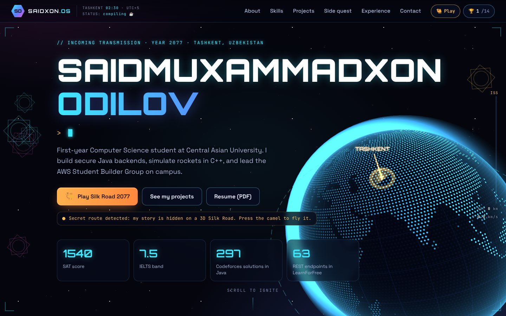
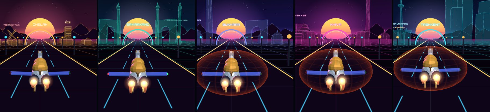
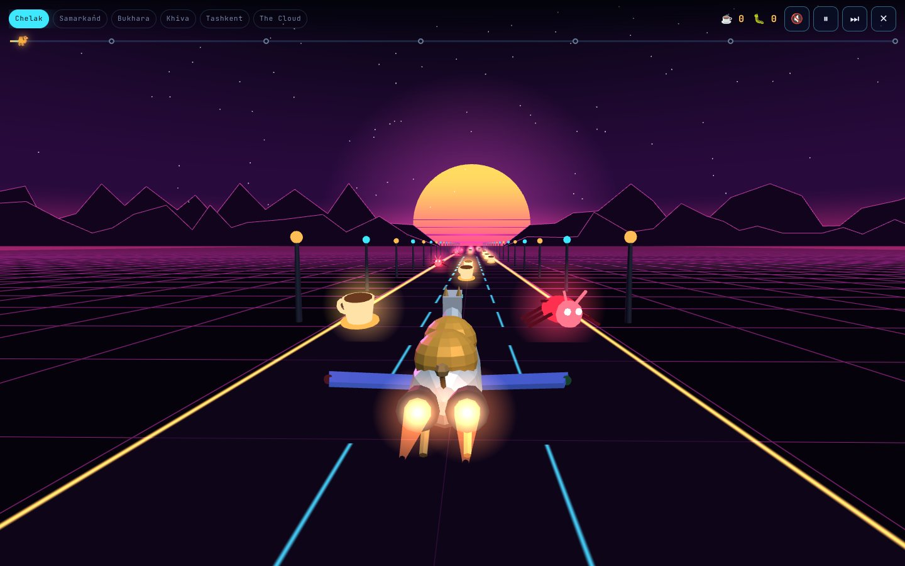
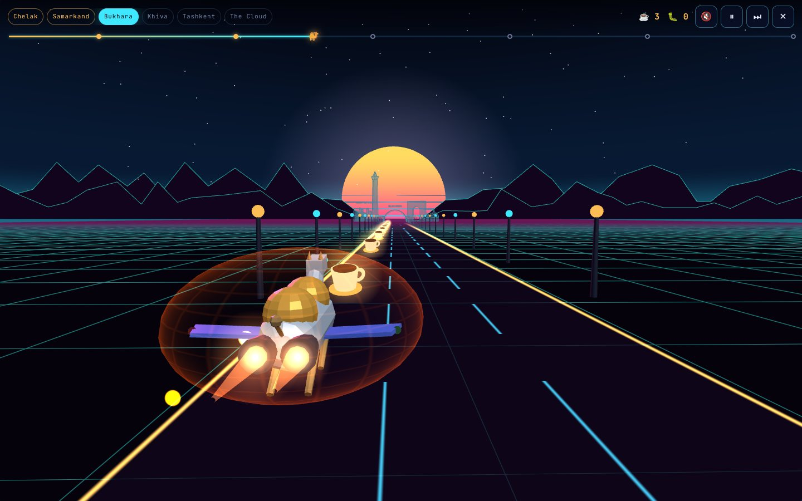
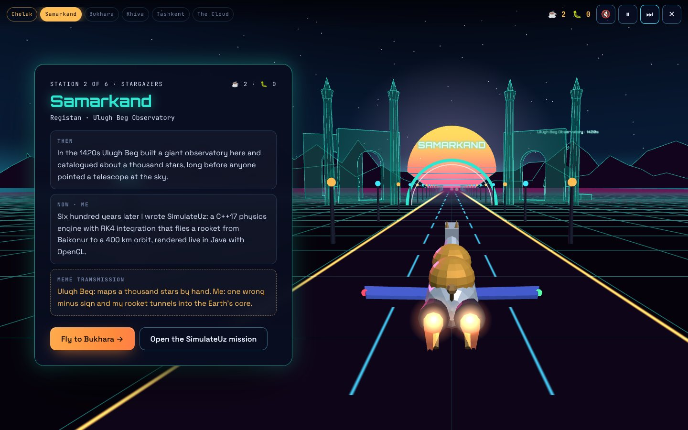
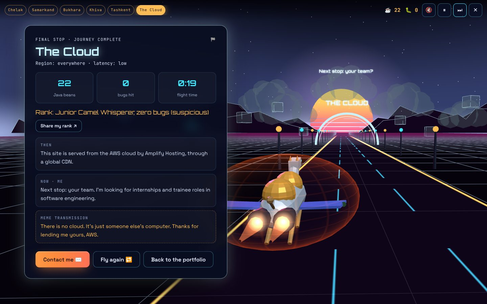
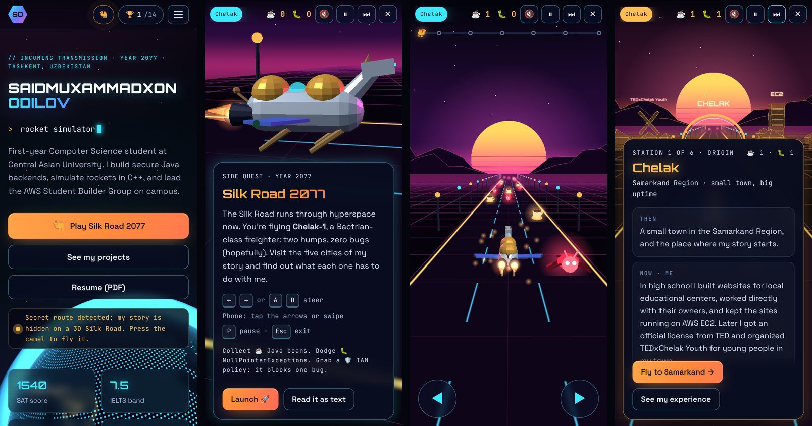
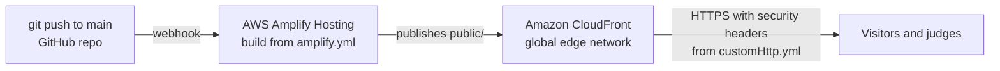

# Silk Road 2077

**The portfolio of Saidmuxammadxon Odilov**, a Computer Science student in Tashkent who builds secure Java backends, simulates rockets in C++, and leads the AWS Student Builder Group at Central Asian University.

It's a 3D, slightly fictional, slightly meme-powered website. My story is hidden on a Silk Road in the year 2077, and you can fly it in a two-humped camel spaceship.

**Live site:** _deploying on AWS Amplify Hosting (link coming here)_
**Built for:** the AWS student portfolio hackathon, hosted on AWS Amplify Hosting



---

## The creative feature: fly the Silk Road 2077

The page has a hint right under the main buttons: *"Secret route detected: my story is hidden on a 3D Silk Road. Press the camel to fly it."* Press the camel and a full-screen 3D game opens on top of the page.

You pilot **Chelak-1**, a Bactrian-class freighter (two humps, zero bugs, hopefully), down a neon highway. Collect ☕ Java beans, dodge 🐛 NullPointerExceptions, and stop at five cities. Each city connects a famous scientist from that place to something I actually built:

| Station | Then | Now (me) |
| --- | --- | --- |
| **Chelak** | My hometown in the Samarkand Region | First websites for local educational centers, kept alive on AWS EC2, and TEDxChelak Youth |
| **Samarkand** | Ulugh Beg catalogued about a thousand stars in the 1420s | **SimulateUz**, a C++17 physics engine that flies a rocket to a 400 km orbit |
| **Bukhara** | Ibn Sina read his way through the Samanid royal library | **LearnForFree**, a free learning platform: 63 REST endpoints, Spring Security, a C++ upload inspector |
| **Khiva** | Al-Khwarizmi gave us the word "algorithm" | 297 Codeforces solutions in Java |
| **Tashkent** | Capital of Uzbekistan, where I live now | CS at Central Asian University and the campus AWS Student Builder Group |
| **The Cloud** | Final destination | This site on AWS, and an invitation to get in touch |

On the way:

- **An IAM policy power-up.** After the first city, an orange shield sometimes appears on the road. Fly into it and an AccessDenied bubble wraps the camel, and the next bug that hits you is blocked. Least privilege, finally useful.
- **Every city has its own sky.** As you get close to a city, the horizon, fog, grid and mountains fade into its colors: sunset orange for Chelak, turquoise tiles for Samarkand, lapis for Bukhara, desert neon for Khiva, a blue city night for Tashkent, and a pale sky above the clouds.
- **A progress line** under the top bar, with a dot for each city and a tiny camel moving along it.
- **A rank at the end.** The Cloud shows your beans, bugs and flight time, and gives you a rank, from "Intern (unpaid, but happy)" to "Senior Bean Engineer". **Share my rank** opens your device's share sheet, or copies a brag to the clipboard where sharing isn't available.



The game never gets in the way of the portfolio:

- It's optional. Every fact in the game is also in the normal page, in plain HTML.
- **Esc** or the ✕ button closes it at any time, and you land back where you were.
- **Read it as text** shows the whole route as an accessible text page, and it's the automatic fallback when a device has no WebGL.
- It works with a keyboard (← → or A D, P to pause), touch buttons, or swipes on a phone.
- Every station card links to the matching section of the portfolio.

| Flying | The IAM policy shield |
| --- | --- |
|  |  |
| **A station** | **The finish** |
|  |  |

### Small things to find

- 14 achievements, saved in your browser (the 🏆 counter in the top bar). One of them is for 15 Java beans in a row without a single bug.
- A status bar with the current time in Tashkent and a rotating developer status ("it works on my machine ✓"), and an altimeter that climbs from 0 to the ISS (400 km) as you scroll.
- A satellite circling the globe on a 51.6° orbit, the same target orbit SimulateUz flies to.
- A camel spaceship that flies past every now and then.
- The Konami code (↑ ↑ ↓ ↓ ← → ← → B A) turns on meme mode.
- A custom 404 page for caravans that get lost.
- Add the site to your phone's home screen and it gets its own app icon, named SAIDXON.OS.

## On phones

The whole site and the game are built for touch screens: the layout is single-column, the 3D scene renders fewer stars, the game shows big arrow buttons, and the city cards slide up from the bottom so the 3D scene stays visible. Held sideways, the cards move to the left and the scene shifts right, so the camel stays in view. The buttons on every card stay pinned to its bottom edge, so they're always within reach, even on a 320 px wide screen.



---

## How it runs on AWS



| AWS service | What it does here |
| --- | --- |
| **AWS Amplify Hosting** | Connected to this GitHub repo. Every push to `main` triggers a build and a new deployment automatically, with a history of every deploy. |
| **Amazon CloudFront** (managed by Amplify) | Serves the site from edge locations around the world, so it loads fast from Tashkent and everywhere else. |
| **HTTPS certificate** (managed by Amplify) | The `amplifyapp.com` domain is served over HTTPS with no setup. |

The repo carries its own hosting configuration:

- [`amplify.yml`](amplify.yml): the build spec. The site is plain HTML, CSS and JavaScript, so there is nothing to compile; Amplify publishes the `public/` folder as it is.
- [`customHttp.yml`](customHttp.yml): HTTP headers for every response, including a strict Content-Security-Policy (everything loads from this origin, no inline scripts or styles), HSTS, `X-Frame-Options: DENY`, `nosniff`, and long caching for the fonts.
- A rewrite rule in the Amplify console sends unknown paths to [`404.html`](public/404.html) with a real 404 status.

---

## How it's built

- **No framework, no build step.** Plain HTML, CSS and JavaScript modules. [three.js](https://threejs.org) r186 is vendored locally, and the three fonts are self-hosted, so the site needs nothing from other servers.
- **Only the three.js it needs.** [`tools/three`](tools/three) uses esbuild to bundle only the 54 parts of three.js the site uses, which makes the file about 20% smaller than the full build (151 KB gzipped). To rebuild it: `cd tools/three && npm ci && npm run build`. The site itself still has no build step.
- **Content first.** All About, Skills, Projects, Experience and Contact content is static HTML, so it works without JavaScript, for screen readers, and for search engines. JavaScript only adds the 3D layer and the game on top.
- **Text before 3D.** The 3D globe starts only after the page has painted, so the text shows up first. The game is a separate module that's only downloaded when you press the camel.
- **Adapts to slow devices.** If the 3D globe can't hold about 40 frames per second, it drops to a lower resolution, and then to 30 frames per second. Add `?hq` to the address to turn this off.
- **3D on a budget.** The globe is one sphere with a custom shader that draws the continents as dots from an 8 KB land mask. Coffee cups, bugs and road lights are instanced meshes, the cities are merged geometries, and rendering pauses while the tab is hidden or the game is open.
- **Accessible by default.** Skip link, semantic landmarks, visible focus styles, a focus trap and Esc to close in the game, a full text mode, and support for `prefers-reduced-motion` (the 3D background holds still, and the game drops camera shake and the intro camera swing). An axe-core scan finds no violations on the page, the game cards or the text mode, and Lighthouse scores 100 for accessibility, best practices and SEO.

```
public/                        the deployed site
├── index.html                 all portfolio content
├── 404.html                   lost-caravan page
├── manifest.json              home-screen name and icons
├── assets/css/main.css        design system, layout, game UI
├── assets/js/main.js          navigation, status bar, easter eggs
├── assets/js/hero-scene.js    the 3D globe, satellite, stars and flyby
├── assets/js/achievements.js  the 14 achievements
├── assets/js/sfx.js           sound effects (off until you turn them on)
├── assets/js/silk-road/       the game: flow, 3D models, station content
├── assets/img/                project images, the globe's land mask, app icons
├── assets/vendor/             trimmed three.js (MIT)
└── assets/fonts/              Orbitron, Space Grotesk, JetBrains Mono (OFL)
tools/three/                   rebuilds the trimmed three.js (not deployed)
amplify.yml                    Amplify build settings
customHttp.yml                 security and cache headers
```

### Run it locally

Any static file server works. With Python:

```bash
python3 -m http.server 8080 --directory public
```

Then open http://localhost:8080.

---

## Credits

- 3D: [three.js](https://threejs.org) (MIT license, see `public/assets/vendor/THREE_LICENSE.txt`).
- Fonts: Orbitron, Space Grotesk and JetBrains Mono, all under the SIL Open Font License (see `public/assets/fonts/LICENSES.txt`).
- Coastlines for the globe's land mask: [Natural Earth](https://www.naturalearthdata.com) (public domain), via the world-atlas package.
- Built with help from Claude Code, an AI coding assistant, as a pair programmer.

## Contact

- Email: saidxonodilov47@gmail.com
- LinkedIn: [saidmuxammadxon-odilov](https://www.linkedin.com/in/saidmuxammadxon-odilov/)
- GitHub: [saidkhanodilov](https://github.com/saidkhanodilov)

No camels were harmed in the making of this website.
